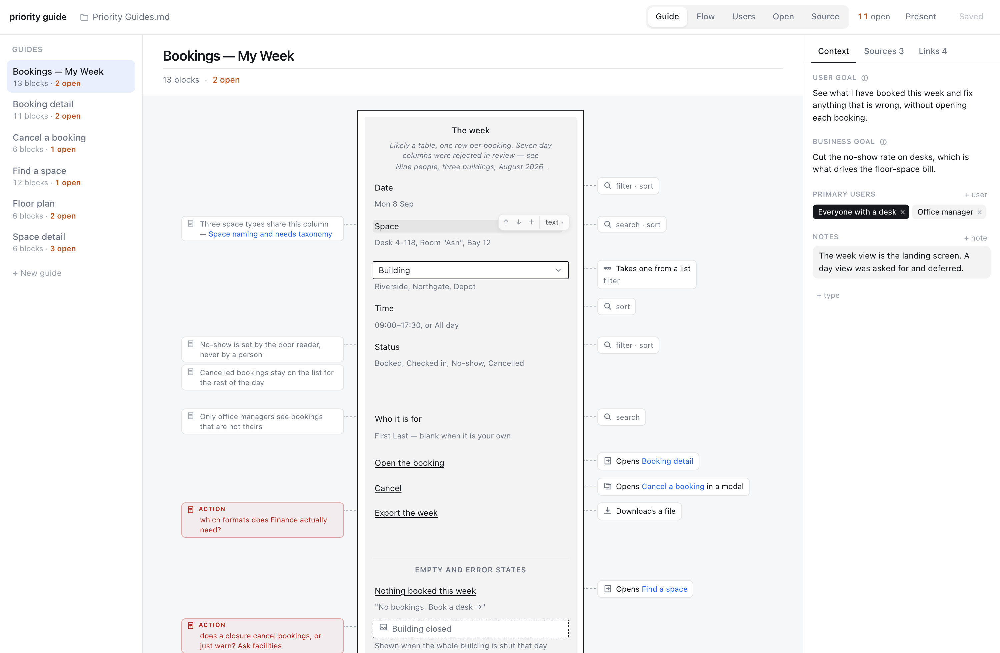
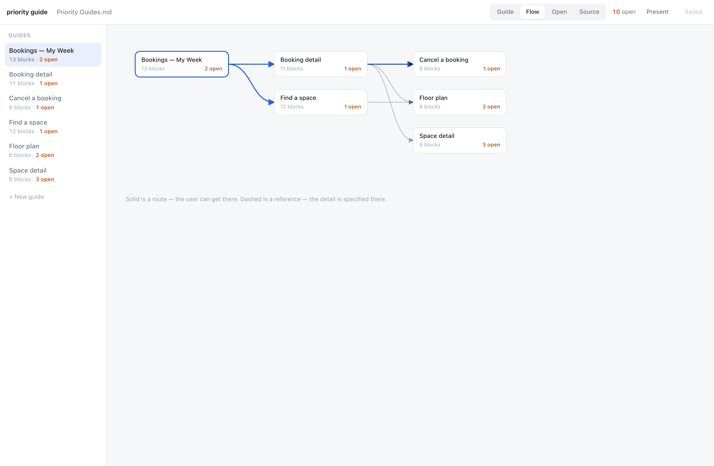

# priority guide

A priority guide is what a screen needs, in order, before anything is laid out.
Content first: what data, what functionality, and what is still unknown.

This is a small local tool for writing them. The file is markdown. The app is a
render of the file, not a database that happens to export one.

It renders the way a priority guide is meant to read: a narrow, stripped-back
stack of what the screen needs, with notes annotating it from the left and
functionality from the right, each on a leader to the one thing it describes.
Everything that is true of the whole guide — what it is for, who it is for, what
it leans on, what points at it — sits in the header and the side panel, so none
of it takes width away from the guide itself.

Everything is edited where it sits: click the text and type. Everything is
**added and moved by dragging** — a palette along the bottom holds every element
a guide can contain, you drag one onto the guide and it lands where you dropped
it, and moving a block anywhere, including into another section, is the same
gesture. There are no forms and nothing to save except the file.

Nothing important hides behind hover: the two side lanes are labelled, and a row
with no note or no functionality still shows where one would go. Selecting a row
puts its controls in the row's own space, under it, where they cannot sit on top
of what you are reading. **Deleting anything is one click and always undoable**,
which is why the app never has to stop and ask you a question.



---

## Why this exists

Priority guides are usually made in a design tool, and three things go wrong there:

| | In a design tool | Here |
| --- | --- | --- |
| **Linking one guide to another** | A hyperlink pinned to an internal node id. It breaks when the target moves or gets duplicated, and the target has no idea it is linked. | `[[Guide name]]` resolves by name, and every guide shows **Referenced by**. Derived on every read, so it cannot go stale. |
| **Attaching a brief, a synthesis, a decision record** | A notes lane sized for one sentence. | A **Sources** block. Write a doc down once, cite it by handle from any guide, section or row. |
| **Working live in a room** | Reordering means dragging boxes inside an auto-layout column. | One gesture for everything structural: drag from the palette to add, drag a block to move it — within a section or into another one. A capture box takes content as fast as someone can say it. |
| **Knowing who a screen is for** | A line of prose. "Sales agent" and "Sales Agent" quietly become two groups. | User types are discrete, picked from the ones already in the file, and the **Users** view turns them around: pick a group, see only their screens, present those. |

And one thing that matters more than any of them: **it is a text file.** It opens
in Obsidian, it renders on GitHub, it reviews in a pull request, and a one-field
edit shows up as a one-line diff.

---

## Getting started

Requires Python 3 and a Chromium browser (Chrome, Edge, Arc, Brave). The File
System Access API, which is how the app reads and writes your folder, does not
exist anywhere else. Nothing is uploaded, and there is no account.

```bash
git clone https://github.com/tylerhagy/priority-guide.git
cd priority-guide
./serve.sh
```

Then click **Open a folder** and pick a folder holding a guides markdown file.
Try `fixtures/` to look around before pointing it at your own work.

To launch it from anywhere:

```bash
ln -s "$PWD/serve.sh" ~/.local/bin/priority-guide
```

---

## The file

One file holds every guide for a project. `##` is a guide, `###` is a section,
one table row is one content block.

```markdown
# Priority Guides — Deskline

## Bookings — My Week

**User goal:** See what I have booked this week and fix anything that is wrong.
**Business goal:** ??
**Primary users:** Everyone with a desk (primary) · Office manager
**Sources:** [brief], [interviews]

### The week

*Likely a table, one row per booking.*

| Content | Real data | Do | Link | Form | Note |
| --- | --- | --- | --- | --- | --- |
| Date | Mon 8 Sep | filter, sort |  |  |  |
| Reference | DL-8841-2 — 4 digits then a checksum | search |  |  | Never reused, even after a cancellation<br>[refs] |
| Status | Booked, Checked in, No-show, Cancelled | filter, sort |  | single select | Set by the door reader |
| Building | Riverside, Northgate, Depot | filter |  | single select |  |
| [Visual] Coverage map | Counties shaded by rep |  |  |  | Roll-up was the top ask — [interviews] |
| Open the booking |  |  | onsite page → [[Booking detail]] |  |  |
| Export |  |  | download |  | ACTION: which formats does Finance need? |

> See [[Booking detail]] — the full field list is specified there.

## Sources

[brief]: https://example.com/wiki/spaces/DL/pages/41007 "Deskline brief"
[interviews]: ./research/2026-08-20-synthesis.md "Nine people, three buildings"
[refs]: <./research/Booking reference format.md> "Why references are 4 digits plus a checksum"
```

A destination containing a space must be wrapped in `<angle brackets>` — that is
CommonMark, and it matters because most real folder paths have a space in them.

### The columns

Columns are matched **by name, never by position**, so you can reorder them, drop
the ones you do not use, or add your own — an `Owner` column is left untouched.

| Column | What goes in it |
| --- | --- |
| **Content** | What the thing is called, and what kind of block it is. `[Visual] Floor plan` is an image or a map, `[Chart: pie] Revenue` a data visual, `[Divider]` a rule. No marker means an ordinary data point, control or action. |
| **Real data** | The example, shown under the name in the middle: the actual format (`123 N Main St, Clio, MI 48420`), or the values when there are under ten. If there are many, say so — the count is what drives the design. **Optional**, and its absence is never flagged. |
| **Do** | `search`, `filter`, `sort`, `edit` — what the user can do to this specific thing. |
| **Link** | `type → [[Target]]`. One of `download`, `mailto`, `modal`, `offsite page`, `onsite page`, `trigger`, `upload`, `other`. |
| **Form** | One of `date picker`, `single line`, `multi line`, `single select`, `multi select`, `other`, plus `required`. |
| **Note** | Everything else about the row, in the left lane. Several notes are separated by `<br>`, which Obsidian and GitHub both render. A note beginning `ACTION:` is an open item; a note that is a `[handle]` is a cited source. |

### Three conventions worth knowing

**`??` is not a blank.** `??` means nobody has been asked. A blank means the
question does not apply here. The app never turns one into the other, and it
counts every `??` as open.

**A comment is not a note.** A note is part of the guide and travels to whoever
reads it. A comment is working material — a question to come back to — so it can
be switched off entirely (`K`), and it is pinned to its block rather than to a
place in the file: reorder the guide, move a block to another section, rename
it, and the comment is still on the same thing. Comments live in a `## Comments`
task list at the end of the file, and the block carries a short id in an HTML
comment that no markdown renderer shows.

```markdown
## Comments

- [ ] `k3f` Should this be one from a list? It only ever has three values.
- [x] `k3f` Renamed, was "Time slot".
```

**`ACTION:` means a follow-up, and only that.** Never an emphasis flag. The
header count is the number of open items, and it is meant to reach zero. Any
note becomes one — and stops being one — in a click.

**What a block is, is a marker in front of its name.** `[Visual]`, `[Chart]`,
`[Chart: pie|bar|line|table|number|map]`, `[Divider]`. Changing a block's kind in
the app keeps its name, its example, its notes and its functionality — you never
rebuild a block to change what it is.

**Functionality, never a visual solution.** `single select`, not `dropdown`. If
you type a visual answer the app says so and asks the question you skipped —
it never blocks you and never rewrites what you wrote.

That is the only thing it ever flags. A block with no example, no note and no
functionality is a perfectly normal block, and the app says nothing about it.

---

## Sources

`## Sources` holds ordinary markdown reference-link definitions, which is the
whole trick: they are valid markdown everywhere, so the same file renders live
links in this app, in Obsidian and on GitHub, with no custom syntax to learn.

```markdown
## Sources

[brief]: https://example.com/wiki/spaces/DL/pages/41007 "Deskline brief"
[policy]: ./decisions.md#late-cancellation "Late cancellation — decided 2026-08-14"
```

Write it once, cite it from a guide, from a section, from any Note, or from a
single content block's `Source` cell — because sometimes the research is about
one field, not the whole screen.

In the app a source is a **title and a link, and nothing else**. The key the file
cites it by is derived from the title and never shown; nobody should have to
invent a key to attach a document. The rail beside each guide lists what is
attached, one click from adding, attaching or detaching, and flags anything cited
but never defined.

A local file path is shown as a path rather than a link, because a page served
over http cannot open one — clicking copies it instead of failing.

A `### Sources` block inside one guide works the same way and is a fine place to
keep something only that guide uses — it still resolves from anywhere, because
that is how markdown reference definitions work.

---

## The four views

| | |
| --- | --- |
| **Guide** | The priority stack, edited in place. What you project in a meeting. Context, sources and links live in the side panel beside it. |
| **Flow** | Every route in the file, drawn. What leads where, and what nothing leads to. |
| **Users** | Every user type, and the guides each one needs. Pick a group and the whole app narrows to their screens — present from there, and the arrow keys walk the set. |
| **Open** | Every `ACTION:` and every `??`, with the block it came from. |
| **Source** | The markdown. |

Beside each guide sit four tabs, and **all four belong to the guide you are
on** — its own goals, its own designs, its own sources, its own links:
**Context** (what it is for, who for), **Design** (what it turned into — drag to
reorder, click a name to rename it, and a Figma link opens in a split view next
to a read-only copy of the guide), **Sources** and **Links**.



---

## Keyboard

| | |
| --- | --- |
| `↑` `↓` | Move the selection |
| Click | Edit whatever you clicked — a name, an example, a note, a heading |
| Drag | Add anything from the palette, or move a block anywhere |
| `Tab` | From a name, start its example |
| `K` | Comments on or off |
| `Esc` | Let go — of a dialog, a field, a menu, then the selected block |
| `⌘S` | Save, including while you are still typing |
| `←` `→` | In present mode, the previous and next screen |
| `C` | Capture — type a line, `Enter`, next line |
| `P` | Present — big type, chrome out of the way |
| `G` `F` `U` `O` `S` | Guide · Flow · Users · Open · Source |
| `⌘S` | Save |

---

## How your file is treated

The parser does not own your file. It owns addressed spans inside it. Every piece
keeps the exact source lines it came from plus a dirty flag; clean pieces are
emitted byte-for-byte, and only a piece you actually edited is regenerated.

Three consequences:

1. **A one-field edit is a one-line diff.** Moving a block is a two-line diff, and
   the moved line is your original text, not a re-render of it.
2. **An untouched file round-trips exactly.** The app checks this on open by
   parsing, re-serialising and byte-comparing. If it does not match, the file
   opens **read-only** and names the first differing line rather than writing to
   something it does not fully understand.
3. **It stays yours.** Edit the same file in Obsidian; the app checks the file on
   disk before every save and asks rather than clobbering.

There is also a ten-deep backup ring in browser storage, and the app refuses to
write output that does not round-trip.

---

## Checking a file without opening it

`validate.mjs` runs the same round-trip gate the app opens on — the same function,
not a reimplementation of it — so a script or an agent that generates a guides
file can prove it is editable before handing it over.

```bash
node validate.mjs fixtures/deskline.md
node validate.mjs fixtures/deskline.md --json
```

```
OK  fixtures/deskline.md

  6 guides · 54 content blocks · 8 routes · 5 sources

    Bookings — My Week                 2 sections · 13 blocks
    Booking detail                     2 sections · 11 blocks
    ...

  6 action items, 4 unanswered — 10 open in total
```

It also reports routes that point at no guide, handles cited but never defined,
sources nothing cites, guides nothing routes to, duplicate guide names, and any
visual answer sitting where functionality belongs. Findings, not verdicts.

---

## Tests

```bash
node test.mjs           # the parser contract — round-trip, minimal diffs, the grammar
node browser-test.mjs   # the real app in Chromium (needs playwright; skips if absent)
```

---

## The Claude skill

`skills/priority-guide/` is a skill for [Claude Code](https://claude.com/claude-code).
Copy it into `~/.claude/skills/` and Claude can draft a guides file from notes, a
transcript or an existing prototype, validate it, and open it here. If you already
have a skill by that name, rename one of them first — a second copy would replace it.

The one rule it carries: **never guess.** An unknown is `??` plus an action item,
not a plausible-sounding invention. A guide padded with confident fiction is worse
than a sparse one, because invented content looks exactly like sourced content.

---

## What this deliberately does not do

- **Layout.** The entire point is that a priority guide has no layout. A tool that
  let you nudge things would be arguing against the method.
- **Multiplayer.** Local, single user, no account, nothing leaves the machine.
- **Fill in unknowns.** `??` plus an action item is the honest state, and the
  count going down is the progress.

---

## Prior art

The idea comes from Heleen van Nues and Lennart Overkamp,
[Priority Guides: A Content-First Alternative to Wireframes](https://alistapart.com/article/priority-guides-a-content-first-alternative-to-wireframes/),
A List Apart, 2018.

MIT licensed.
